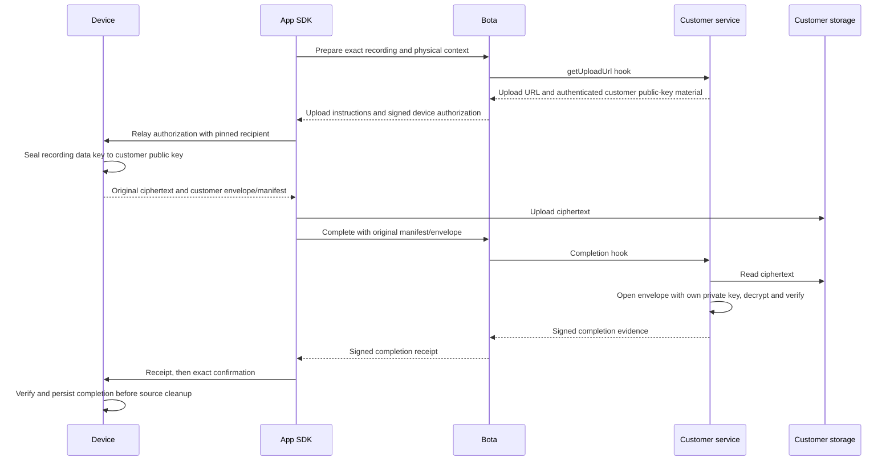

# Firmware Protocol Reference — Bota App SDK

This is the all-English, App-facing firmware integration reference for Bota App
SDK (`@bota.dev/react-native-app-sdk`, `BotaAppSDK`, and `dev.bota:bota-app-sdk`).
New SDK development belongs in this repository. The retired
`bota-dev/react-native-sdk` repository is retained as migration history.

The React Native `/runtime` entry executes generated Rust-to-JS code over narrow
OS ports. The SDK may relay bounded ciphertext and signed documents internally
in JS; device/backend retain signature trust and decryption. This changes the
SDK execution location, not these wire formats or cleanup requirements. Native
facades use opaque registrations. See
[runtime source review](docs/parity/react-native-runtime.md).

This reference covers the App-facing GATT allocation, provisioning and settings,
status, recording control, legacy and encrypted recording transfer, customer BYO
storage, diagnostics, factory reset, BLE firmware upload, recording markers and
nearby find. It describes current SDK source contracts; it is not a manufacturing
specification or proof that every firmware build or SDK package enables them.

## Contents

- [Protocol authority and notation](#protocol-authority-and-notation)
- [GATT services](#gatt-services)
- [Provisioning, WiFi and device settings](#provisioning-wifi-and-device-settings)
- [Device status](#device-status)
- [Recording list and legacy transfer](#recording-list-and-legacy-transfer)
- [Encrypted upload v2](#encrypted-upload-v2)
- [BYO customer storage](#byo-customer-storage)
- [Authenticated factory reset](#authenticated-factory-reset)
- [Device diagnostics](#device-diagnostics)
- [Firmware upload](#firmware-upload)
- [Recording markers](#recording-markers)
- [Nearby find](#nearby-find-over-ble-development-contract-october-16)

## Protocol Authority and Notation

The [protocol manifest](protocol/manifest/device-protocol.yaml) owns UUIDs,
constants, layouts and limits. [Rust codecs](core/device-sdk-core/src/protocol/)
and [workflows](core/device-sdk-core/src/workflow/) implement parsing, admission
and ordering. [Generated constants](core/device-sdk-core/src/generated/protocol.rs)
are checked with `cargo xtask protocol generate --check`; this Markdown reference
is maintained alongside them, not emitted by that command.

Offsets are zero-based and lengths are bytes. `u16LE`, `u32LE` and `u64LE` mean
unsigned little-endian integers; `BE` explicitly denotes big-endian. UUID[16]
means the exact UUID bytes, not a string or four-byte legacy file identifier.
Packet types are scoped to their characteristic and protocol version: the same
numeric opcode in another family does not have the same meaning. Respect the
actual ATT-value capacity; a requested MTU is not proof of negotiated capacity.

The retired React Native SDK reference supplied the topic checklist, not current
authority. In particular, its reset grant, release status and optional transfer
behavior must not override this repository's current implementation.

## Integration Documents

Read this entry point for behavior, BLE allocation and SDK/App boundaries, then:

- [Marker security and binary format](docs/firmware/recording-markers-security.md): context, marker bodies, encryption, signature domains, BATCH HTTP and durable recovery.
- [Protected direct STREAMING](docs/firmware/protected-streaming.md): device admission, key grant, audio/marker ACKs, all HTTP endpoints, retry/expiry and final proofs.
- [Interoperability fixtures](docs/firmware/vectors/README.md): downloadable test-only bytes, verification command and required rejection cases.
- [BYO integration](docs/parity/byo-storage.md) and [customer envelopes](docs/parity/byo-upload-encryption.md): storage ownership, recipient selection and recovery.
- [Upload recovery](docs/parity/upload-recovery.md): cloud completion, local durability and cleanup boundaries.

These appendices are part of this contract and keep transport delivery, durable
marker acceptance, final publication and local deletion as separate outcomes.

## Availability and Compatibility

Support is specific to the protocol, SDK execution path and target firmware.
The [beta.19 publication record](release/evidence/2.0.0-beta.19-publication.md)
records that release's artifacts; it does not qualify later source or every
physical device. Marker/status capability history is recorded in the
[marker review](docs/parity/recording-markers.md). Nearby find remains a separate
development contract below. Integrators need matching qualified firmware,
backend and SDK/App builds; service discovery alone must not enable a transfer.

This documentation change publishes no SDK package, changes no wire format,
enables no firmware profile and establishes no new hardware qualification.

Ordinary unmarked v2 messages remain unchanged. Protected STREAMING is disabled
by default and has no new BLE audio relay in this scope. A device can perform
protected direct capture with existing App start/stop controls when firmware and
backend admission permit it; that does not make old SDKs marked-BATCH capable.

## GATT Services

Custom service UUIDs are `B07Axxxx-0000-1000-8000-00805F9B34FB`.
Characteristic shorthand `xxxx/yyyy` expands to
`B07Axxxx-yyyy-1000-8000-00805F9B34FB`. The complete name/UUID mapping is in the
[manifest](protocol/manifest/device-protocol.yaml).

| Service | Allocation | App-facing use |
| --- | --- | --- |
| Device Information | Standard `180A` | Manufacturer `2A29`, model `2A24`, serial `2A25`, hardware `2A27`, firmware `2A26` |
| Battery | Standard `180F` / `2A19` | Battery level |
| AUDIO | `0001` | Data `0001`, codec `0002`, control `0003`; allocation alone does not enable a recording relay |
| CONTROL | `0002` | Device status `0001`, recording control `0002`, recording status `0003`, time sync `0004`, device command `0005` |
| PROVISIONING | `0003` | Pairing state `0001`, token `0002`, API endpoint `0003`, WiFi config `0004`, result `0005`, settings `0006` |
| STORAGE | `0004` | Storage info `0001`, legacy list `0002`, legacy transfer `0003`, legacy control `0004`, legacy status `0005`; v2 allocation `0006` through `000C` below |
| AUTH | `0005` | Device public key `0001`, nonce `0002`, historical backend public key `0003`, device certificate `0004` |
| WIFI_CONFIG | `0006` | Grant `0001`, credential `0002`, status `0003`, scan `0004` |
| DIAGNOSTICS | `0007` | Control `0001`, data `0002` |
| IDENTITY | `0008` | Manufacturing serial alias `0001` for Web Bluetooth, which blocks standard `2A25`; native clients retain standard identity reads |
| FIND | `0009` | Capabilities `0001`, control `0002`, status `0003`, grant `0004`; see the dedicated contract below |

An advertised name is not authenticated device identity. Discover the required
characteristics and read the actual capability before choosing an upload path.
Subscribe before issuing commands that can reply immediately. Scope ownership
to the account, physical device and connection generation; late callbacks from
a retired connection cannot complete a replacement operation.

## Provisioning, WiFi and Device Settings

Provisioning reads `AUTH_NONCE` and `PK_D` (the workflow requires a 64-byte
device public key), obtains authorized host material, subscribes to
`PROVISIONING_RESULT`, writes the one-byte API endpoint selector and delivers
token chunks to `DEVICE_TOKEN`. This endpoint field is not a URL string.
Each token chunk is `index:u8 || count:u8 || data`,
with zero-based index; the core limits each data portion to `MTU - 7` and the
chunk count to 255. A write acknowledgement alone is not provisioning success.
Pairing states are 0 unpaired, 1 pairing, 2 paired and 3 error; provisioning
results are 0 success, 1 invalid token, 2 storage error, 3 chunk error and
4 already paired. See the [provisioning workflow](core/device-sdk-core/src/workflow/provisioning.rs).

Time sync on `0002/0004` is eight bytes: Unix seconds u32LE, milliseconds
within the second u16LE, then timezone offset in minutes i16LE.

WiFi grant and credential handling uses `0006/0001` and `0006/0002`.
The credential codec emits `ssid_length:u8 || ssid:UTF8 || password_length:u8 ||
password:UTF8`, bounded to 32/64 bytes, with no embedded NUL. Disconnect is the
single byte `00`; an empty SSID cannot carry a password. These codec bytes do
not bypass device authorization. Scan starts with `01` on `0006/0004`.
Connection status values are 0 idle, 1 connecting, 2 connected, 3 failed and
4 disconnected. See [encoders](core/device-sdk-core/src/protocol/encode.rs) and
[status/scan decoders](core/device-sdk-core/src/protocol/provisioning.rs).

`DEVICE_SETTINGS` (`0003/0006`) writes use a 12-byte version-2 packet:

| Offset | Field | Encoding |
| --- | --- | --- |
| 0 | Version | `02` |
| 1 | Enabled connections | Bit0 WiFi, bit1 cellular |
| 2..4 | Upload priority | 1 WiFi, 2 BLE, 3 cellular in priority order; 0 terminates |
| 5 | Cellular idle timeout | 10-second units |
| 6 | WiFi idle timeout | 10-second units |
| 7 | Streaming enabled | Boolean byte |
| 8 | Streaming flush interval | Seconds; encoder caps at 128 |
| 9 | Heartbeat mask | Bit7 explicit, bit0 WiFi, bit1 cellular |
| 10..11 | Unset extension bytes | Current shared settings encoder writes zero |

Idle timeout 0 is immediate, 1..254 means 10..2540 seconds, and 255 means
always on. A positive input below ten seconds encodes as 1. Without heartbeat
bit7, the decoder uses the legacy both-enabled default. It accepts version 1/2
with at least eight bytes and reports unsupported layouts separately from the
fallback settings. Model normalization can disable unsupported cellular options.
The archived SDK's explicit `recording_mode` byte10 is not exposed by this
shared settings model; do not claim that API from the historical document.
See [settings codec](core/device-sdk-core/src/protocol/settings.rs).

## Device Status

`DEVICE_STATUS` (`0002/0001`) has a minimum 14-byte payload, with optional fields:

| Offset | Field | Encoding |
| --- | --- | --- |
| 0 | Battery level | u8 percent |
| 1 | LTE status | u8 |
| 2 | Device state | u8 |
| 3 | Pending recordings | u8 |
| 4..7 | Last time sync | Unix seconds u32LE |
| 8 | Flags | Charging, low battery, storage full, WiFi connected, LTE connected, sync active: bits0..5 |
| 9..10 | Total storage | u16LE MB |
| 11..12 | Used storage | u16LE MB |
| 13 | LTE signal quality | u8; 99/255 mean unknown |
| 14 | WiFi status | Optional u8 |
| 15..16 | Battery voltage | Optional u16LE mV; zero means unavailable |
| 17.. | Modem information | Optional UTF-8 `KEY=value` lines |

`STORAGE_INFO` (`0004/0001`) is at least 12 bytes: total KiB u32LE, used KiB
u32LE, total recordings u16LE, pending-sync count u16LE. Storage-info KiB and
device-status MB are different units. Recording activity/result notifications
on `0002/0003` have their own [layouts below](#recording-control-and-status).
See [status decoder](core/device-sdk-core/src/protocol/status.rs).

## Recording List and Legacy Transfer

LIST is `01` on `0004/0004`. Entries on `0004/0002` are 24 bytes:

| Offset | Field | Encoding |
| --- | --- | --- |
| 0..3 | File ID | Four bytes |
| 4 | Flags | Bit0 encrypted at rest |
| 5..15 | Reserved | Not part of the ID |
| 16..19 | Started at | Unix seconds u32LE |
| 20..21 | Duration | Seconds u16LE |
| 22..23 | Size | KiB u16LE |

The SDK represents this file ID as four bytes plus twelve zero bytes in a
UUID-shaped identifier. It is not a full capture UUID. The decoder accepts
packed entries and the historical one-byte-prefixed entry batch; do not invent
full recording identity from filename, catalog order or padding.

```text
SDK -> device  CONTROL: 02 || legacy_file_id[4] || zero[12]
device -> SDK  TRANSFER: DATA ... DATA ... EOF
SDK -> device  CONTROL: ACK/NACK || sequence:u16LE
SDK -> backend: upload and durable completion
SDK -> device  CONTROL: 07 || same_legacy_file_id[4] || zero[12]
```

Control is `0004/0004`; transfer notifications are `0004/0003`.

| Type | Transfer frame |
| --- | --- |
| `01` DATA | Type, sequence u16LE, length u16LE, payload |
| `02` EOF | Type, sequence u16LE, CRC32 u32LE |
| `03` PAUSED | Type, sequence u16LE, optional bytes-sent u32LE; live capture has caught up |
| `04` SHA256 | Type, digest[32]; historical firmware may append a file reference |
| `05` E2E_START | Type, ephemeral public key[32], salt[4] |
| `81` ENCRYPTED_DATA | Type, sequence u16LE, length u16LE, encrypted chunk |
| `82` ENCRYPTED_EOF | Type, sequence u16LE; CRC is not content verification for this profile |
| `FF` ERROR | Type, sequence u16LE, numeric error code |

Final ACK is `10`, NACK `11`, abort `12`, each followed by sequence u16LE.
DATA does not require an ACK per notification. Keep sequence/size/integrity and
durable-file checks in the selected workflow. The shared SHA256 decoder returns
the 32-byte digest; it does not authenticate an appended recording reference.
The historical encrypted relay is distinct from canonical encrypted-v2 storage.
See [packet parsing](core/device-sdk-core/src/protocol/recordings.rs),
[encoding](core/device-sdk-core/src/protocol/transfer.rs) and
[upload recovery](docs/parity/upload-recovery.md).

### Confirm Delete and Direct Upload Trigger

Legacy `07` confirmation is allowed only after the host's durable cloud-complete
step, never immediately after BLE EOF or HTTP PUT. Retain failed/pending work
for recovery. A local transport ACK does not authorize deletion.

`03` on legacy transfer control requests device-direct upload. Its response is
`03 || result:u8`: 0 accepted, 1 no network, 2 busy, 3 no token. Accepted means
the device admitted work, not that cloud verification or cleanup finished.

## Encrypted Upload v2

Canonical encrypted storage keeps audio ciphertext and authenticated manifests
unchanged through the SDK. It is independent of legacy plaintext and P10 relay.

| STORAGE characteristic | Suffix | Use |
| --- | --- | --- |
| CAPABILITIES_V2 | `0006` | Fresh 24-byte capability read |
| SIGNED_BLOB_V2 | `0007` | Framed opaque signed documents |
| CONTROL_V2 | `0008` | LIST, START/RESUME, WINDOW_ACK, CONFIRM, ABORT |
| TRANSFER_V2 | `0009` | Data, manifests and errors |
| STATUS_V2 | `000A` | Transfer/completion status |
| LIST_V2 | `000B` | Full-UUID catalog entries and END |
| UPLOAD_CONTEXT_V2 | `000C` | Attempt-bound context read/write/notify |

1. Discover characteristics and read capabilities. Absent capability means
   unsupported; a failed read/discovery is an error, not permission to downgrade.
2. Establish the upload-only physical context. BEGIN is `65 02 00 00 ||
   attempt_id:u32LE`, nonzero. Snapshot reads start with `66 02 state 00 ||
   attempt_id:u32LE || result:u16LE || length:u16LE`, then payload. States are
   0 pending, 1 nonce[16], 2 proof[116..366], 3 accepted, 4 failed. Notifications
   are read hints; polling does not renew the independent 30-second deadline.
3. Deliver signed-blob kind3 challenge (196 bytes) and kind4 result (264 bytes).
   Device acceptance, not fragment delivery, establishes context. Context does
   not reuse pairing/grant nonce authority.
4. LIST uses `25` on CONTROL_V2. Subscribe to LIST_V2 and TRANSFER_V2 first;
   correlate ENTRY/END/errors to the transport session. Validate full UUID,
   generation, count and catalog digest before selecting a recording.
5. Admit the exact authorization, owner revision, recording identity and file
   evidence before START/RESUME. Ordinary `BOTAAUT2` is 408 bytes with document
   version2, transport profile3 and storage format3. SDK structural validation
   does not replace firmware signature/time checks. Marked extensions below
   have their own lengths and proof requirements.
6. Persist the exact received prefix before WINDOW_ACK. Validate the full
   ciphertext and manifest, then perform the selected backend completion flow.
7. Deliver the exact signed receipt and CONFIRM. Preserve uncertain completion
   for recovery; neither PUT success nor cancelled monitors prove device cleanup.

Context admission requires mask `0x17f`; expired-session recovery requires
`0x37f`. A replacement must advance owner revision, change session and retain
the immutable recording/ciphertext identity. Do not silently start a legacy
transfer after v2 admission fails. `BACKEND_PUBKEY` presence does not select v2.
Use the actual ATT capacity for the 140-byte ordinary START_ACK (MTU at least
143) and advertised limits for other frames.

See [context/catalog contracts](docs/parity/v2-demo-protocol.md),
[managed backend integration](docs/parity/v2-managed-backend.md),
[wire codecs](core/device-sdk-core/src/protocol/encrypted_upload_v2.rs), and
[completion recovery](docs/parity/upload-recovery.md). Protected direct
STREAMING below is a separate device HTTP contract, not an implicit BLE relay.

## BYO Customer Storage

BYO uses independent version-3 RPC frames on STORAGE CONTROL_V2 (`0008`) and
TRANSFER_V2 (`0009`). It shares the characteristics, not the ordinary v2 command
namespace. Serialize ownership and subscribe before writing.

| Offset | Field | Encoding |
| --- | --- | --- |
| 0 | Kind | `70` request, `71` response, `72` pull (hex) |
| 1 | Version | `03` |
| 2 | Operation | 1..13 below |
| 3 | Status | Requests/pulls: 0; response: 0..3 |
| 4..7 | Request ID | Nonzero u32LE |
| 8..9 | Fragment offset | u16LE |
| 10..11 | Total document length | u16LE |
| 12.. | Payload | Opaque bytes |

Frames are at most 512 bytes and must also fit actual ATT capacity; documents
are bounded to 8192 bytes. A pull carries no payload and total=0. Non-pull
offset plus payload length cannot exceed total. Non-success responses have no
payload. Correlate request ID/operation and reject conflicting fragments.

| Operation | Name | Operation | Name |
| --- | --- | --- | --- |
| 1 | CAPABILITIES | 8 | LIST |
| 2 | INSPECT | 9 | LIVE_SNAPSHOT |
| 3 | OPEN | 10 | LIVE_READ |
| 4 | READ | 11 | LIVE_ACK |
| 5 | RECEIPT | 12 | LIVE_CONTEXT |
| 6 | CONFIRM | 13 | LIVE_SUCCESSOR |
| 7 | ABORT | | |

The customer-storage flow is:



The diagram shows the App relay path; device-direct radio ownership is not
transferred to BLE by this flow. App/backend HTTP calls use the authorized proxy
boundary described in [BYO integration](docs/parity/byo-storage.md).

Content encryption uses fixed BOTAENC2 ChaCha20-Poly1305 with a per-recording
data key. HPKE X25519/HKDF-SHA256/ChaCha20-Poly1305 seals that data key to the
authorized customer's public key before customer-storage upload. The customer
uses its private key to open the envelope; it never requests a decryption key
from Bota. The SDK relays original ciphertext and documents, without decrypting
or creating a second encrypted file. TLS/BLE transport protection is a separate
layer. This is not a selectable encryption-algorithm plug-in interface.

Persist selected intent, authorization and original manifest for retries. URL
renewal cannot rotate the pinned recipient. Once selection is durable, customer
outage is not permission to fall back to Bota storage. Source cleanup requires
verified, durably persisted completion and the exact receipt confirmation;
completion-response loss is not permission to repeat PUT. Live HTTP/WS and
whole-file successor recovery retain their own fencing and receipt gates.
See [customer-envelope responsibilities](docs/parity/byo-upload-encryption.md),
[BLE codec](core/device-sdk-core/src/protocol/byo_ble.rs) and
[recovery/integration](docs/parity/byo-storage.md).

## Authenticated Factory Reset

Remove-only deprovision (`05`) is not destructive-reset authorization.
Use the current nonce, exact backend reset command and binding generation to
obtain the dedicated 179-byte reset envelope. It contains a generation u32BE
prefix, HPKE P-256 encapsulation[65], and authenticated ciphertext[110]. The
signed plaintext has version2 and reset-only scope `10` hex. Reject the old
171-byte deprovision grant and any generation mismatch.

1. Subscribe to `PROVISIONING_RESULT` (`0003/0005`). Deliver the reset grant to
   `DEVICE_COMMAND` (`0002/0005`), then `06 || binding_generation:u32BE`.
2. Firmware verifies authorization and performs the durable local wipe. Success
   is exactly `00 || local_recordings_deleted:u16LE` (three bytes).
3. Persist that result before sending explicit delivery receipt `0A` on
   DEVICE_COMMAND. Removing a subscription is not a receipt.
4. On reconnect, recover the saved/replayed result and receipt without replaying
   the destructive grant/opcode. The application separately finalizes the exact
   authenticated backend command.

The reset deletion boundary excludes cloud recordings and lifetime manufacturing
identity. See the [reset authorization contract](docs/parity/factory-reset-authorization.md)
and [durable workflow](core/device-sdk-core/src/workflow/factory_reset.rs).

## Device Diagnostics

Diagnostics uses control `0007/0001` and notification data `0007/0002`.
Raw debug logging and production fault history are separate operations and
cannot concurrently own the same subscription. Raw logging depends on the
firmware debug build gate; service presence does not enable it in production.

Raw log START/STOP are `01`/`00`. Notifications are sequence u16LE, flags u8,
then UTF-8 bytes. Bit0 marks backlog and bit1 dropped bytes. Lines may span
notifications; a sequence gap/drop clears the buffered partial line. Subscribe
before START and quiesce callbacks during teardown.

Production fault LIST is `10`; ACK is `11 || event_id:u64LE`; capability request
is `12`. ACK only exact events accepted by the backend.

| Frame | Bytes | Payload after opcode |
| --- | --- | --- |
| `90` META | 17 | Index u8, type u8, reason u16LE, uptime u32LE, event ID u64LE |
| `91` SIGNATURE | 10 | Index u8, signature u64LE |
| `92` END | 2 | Count u8 |
| `93` ACK result | 10 | Status u8, acknowledged event ID u64LE |
| `94` Capabilities | 3 | Version u8, maximum batch u8 |
| `95` DETAIL | 7..20 | Index u8, offset u16LE, total u16LE, 1..14 detail bytes |

Version1 detail is exactly 176 bytes. Reject incomplete/reordered/conflicting
detail; emit a complete batch only at END. Preserve event IDs/signatures as
16 lowercase hex characters rather than floating-point numbers. Reset the
assembler between reads and fence old subscription callbacks; there is no wire
read ID. The shared report decoder ignores ACK/capability frames instead of
treating them as report completion. See the [complete detail and ABI contract](docs/parity/diagnostics-codec.md)
and [native integration](docs/parity/native-diagnostics.md).

## Firmware Upload

BLE firmware upload uses legacy STORAGE control `0004/0004`, transfer
`0004/0003` and status `0004/0005`. Keep the status subscription for the entire
operation, including acknowledgements arriving before the host begins waiting.

```text
SDK -> device  CONTROL: 08 || file_size:u32LE
device -> SDK  STATUS:  08 || result:u8
SDK -> device  TRANSFER: 20 || sequence:u16LE || firmware_bytes
device -> SDK  STATUS:  10 || acknowledged_sequence:u16LE
SDK -> device  CONTROL: 09 || crc32:u32LE
device -> SDK  STATUS:  09 || result:u8
```

The manifest sets maximum firmware payload to 500 bytes and ACK window to
eight packets. Enforce transport capacity before transfer. Nonzero start/verify
results and missing required ACKs fail the operation; never claim successful
update from bytes sent alone. The packet decoder retains numeric status;
board-specific file/application errors are firmware evidence, not invented
success. This describes the BLE file-transfer protocol, not release selection,
signature policy or proof that an update booted. See the
[OTA codec](core/device-sdk-core/src/protocol/ota.rs) and
[firmware-update workflow](core/device-sdk-core/src/workflow/firmware_update.rs).

## Recording Markers

### Recording Marker Behavior

1. Start one logical recording through the device button or authorized App control. The device owns its UUID, generation and media clock.
2. During recording, each valid short press creates one marker. Nominal short press is 40ms ≤ duration < 750ms, dispatched on qualified release; long press starts/stops according to device state. Separate short presses remain distinct even at the same media time. There is no App command to create/edit a marker in this scope.
3. Record the marker ID, sequence and original-audio media offset. Successful marker feedback is a 100ms white flash with no vibration. BATCH confirms after local persistence/read-back; protected STREAMING confirms only after verifying the exact backend durable marker ACK. Queue/capacity rejection does not invent a marker or damage an already persisted BATCH prefix. A late ACK after stop does not start another white flash.
4. Stop capture promptly, seal the audio and the complete marker set, including an explicit zero-marker set. Network completion is asynchronous.
5. The backend verifies and publishes the audio and marker snapshot together. Playback seeks the original audio; AI freezes the sealed revision/hash and transcript version for annotations and summary attention hints.
6. BATCH deletes local payload only after exact audio + marker completion proofs and authenticated durable local terminal read-back. Protected STREAMING has no durable local recording to delete; pending RAM is not a power-loss backup.

| Mode | Capture/storage | Upload owner | Marker-success evidence | Completion |
| --- | --- | --- | --- | --- |
| BATCH | Encrypted local audio and protected marker journal | Firmware Wi-Fi/4G or native SDK BLE relay under one authorized owner | Verified local persistence | Backend dual proofs plus local terminal persistence before deletion |
| Protected STREAMING | Bounded encrypted RAM; no durable recording copy | Firmware Wi-Fi/4G direct worker | Exact signed backend marker ACK | Verify final audio proof, marker proof and exact snapshot; App JSON is informational |

The thresholds describe recording-marker input, not a new remote marker command.
Device state and authorization still decide whether a start/stop request is
allowed.

### Recording Control and Status

Use the existing secure connection/binding and a valid recording-scope grant.
Connection alone grants no recording or upload permission. The native SDK should
own GATT operations; an App should not handcraft signed material in JavaScript.

UUIDs below are complete: replace `xxxx` in
`B07A0002-xxxx-1000-8000-00805F9B34FB` or `B07A0004-xxxx-1000-8000-00805F9B34FB`
with the listed four hex digits.

| Service / characteristic | Direction / use |
| --- | --- |
| `B07A0002 / 0001` DEVICE_STATUS | Device status; native `getStatus().flags.syncActive` reports upload ownership |
| `B07A0002 / 0002` RECORDING_CONTROL | App → device: one-byte `10` hex START or `11` hex STOP, after existing grant admission |
| `B07A0002 / 0003` RECORDING_STATUS | Device → App: read/notify activity snapshot or result notification |
| `B07A0004 / 0006` CAPABILITIES_V2 | Read existing 24-byte transfer capability document and enforce resource ceilings |
| `B07A0004 / 0007` SIGNED_BLOB_V2 | App → device signed opaque bundle transport; receive result through the existing characteristic mechanism |
| `B07A0004 / 0008` CONTROL_V2 | App → device transfer commands |
| `B07A0004 / 0009` TRANSFER_V2 | Device → App audio, manifest, marker chunks and EOF |
| `B07A0004 / 000A` STATUS_V2 | Existing transfer status |
| `B07A0004 / 000B` LIST_V2 | Recording directory results |
| `B07A0004 / 000C` UPLOAD_CONTEXT_V2 | Existing authenticated upload-context exchange |

The compatibility API uses `requestStartRecording` / `requestStopRecording`.
Device dispatch goes through `ble_recording_control → orchestrator → recorder`;
enabled protected mode enters the direct worker after admission. Protected
ownership is established before recording=true is notified.

RECORDING_STATUS has two distinct packet shapes:

| Length | Bytes | Meaning |
| --- | --- | --- |
| 18 | active u8@0; initiated_by u8@1; UUID[16]@2 | Activity/recording identity. Current firmware writes initiated_by=0, so do not use it to infer actual button versus App origin. |
| 6 | active u8@0; zero bytes@1..4; result u8@5 | Command result. Never interpret byte 5 of an 18-byte snapshot as a result. |

Result values: `00` success, `01` error, `02` already recording, `03` not
recording, `04` invalid grant, `05` grant expired, `06` invalid state. These are
recording-control results, not marker persistence or upload completion proofs. A
successful control ATT write alone is not confirmation that capture
started/stopped.

### Marked BATCH Transfer

Reuse the existing encrypted-upload-v2 transfer. Transport integers in the
tables below are little-endian; this does **not** override endian rules inside
signed/encrypted documents. Keep those bytes opaque. UUIDs use RFC byte order;
never transmit a C struct. JSON u64 values remain decimal strings, not
JavaScript numbers.

Existing CONTROL_V2 message codes: `20` START, `21` WINDOW_ACK, `22`
RESUME_REQUEST, `23` CONFIRM, `24` ABORT, `25` LIST (hex). The common 12-byte
header is message type u8@0, protocol version u8@1, flags u16@2, transport
session ID u64@4. The transport ID is not the backend session UUID.

1. Read capabilities and establish the existing authorized upload context/owner.
2. Send LIST with `request_flags` u32@12 bit0 set to include marked entries; total LIST length is 16 bytes. Legacy flags=0 omits marked recordings.
3. A 96-byte directory entry has `completion_state=2` at byte 33 for marked recordings; native maps this to `markersRequired=true`. This means the audio is locally committed and marker metadata is required, **not** that cloud completion permits deletion.
4. Native provider first GETs saved marker authorization. Only an explicit pre-manifest 404 permits new admission; 403/409/5xx must not open another owner.
5. Send blob kind 5: audio authorization408 + capture context176 + marker authorization280 = **864 bytes**. It must match the exact recording/generation/session/owner and negotiated limits.
6. Transfer encrypted audio/manifest and all marker documents. Marker chunks are emitted before EOF. New START/RESUME replays the metadata; preserve exact documents and request identities.
7. After the audio manifest, submit the encrypted marker seal/pages to the backend. Await both durable final receipts. Send blob kind 6: audio receipt336 + marker receipt296 = **632 bytes**, then the existing CONFIRM flow. Keep existing audio-prefix hash semantics: hash the audio 408/336-byte prefix where required, not the whole marked bundle.
8. During kind6 COMMIT, firmware verifies signatures, context, owner and exact content, then persists/read-backs its authenticated local terminal before successful blob RESULT. CONFIRM separately rechecks identity and that terminal before deleting audio and subsequently sidecars. Incomplete/conflicting proof keeps the payload.

Signed blob wrapper (existing transport): BEGIN `60`, DATA `61`, COMMIT `62`,
ABORT `63`, RESULT `64` (hex). Common prefix: code/version/kind/reserved=0 at
bytes0..3, write_id u32@4. BEGIN length42 adds total_length u16@8 and
SHA256[32]@10; DATA adds offset u16@8, chunk_length u16@10 and bytes@12;
COMMIT/ABORT length8; RESULT length10 adds result u16@8. Enforce
write/session/connection identity, exact length/hash and negotiated MTU.
Fragment reception or blob RESULT is not a backend persistence proof.

### Marked Authorization, START and CONFIRM

All offsets below are absolute byte offsets. Transfer headers use protocol
version `2`; reserved fields and undefined flags are zero. Size checks precede
allocation. Before writing kind5, require maximum_signed_blob_bytes >= 864;
kind6 requires >= 632. Do not send a shortened bundle if the device cannot fit
it. The blob's SHA-256 covers the entire bundle, while START/CONFIRM retain
their original audio-prefix hashes.

| Bundle | Offset | Length | Opaque component |
| --- | ---: | ---: | --- |
| kind5 | 0 | 408 | Original audio authorization |
| kind5 | 408 | 176 | Capture identity/context |
| kind5 | 584 | 280 | Marker authorization, BOTAMRK1 kind `0x1003` |
| kind6 | 0 | 336 | Original audio completion receipt |
| kind6 | 336 | 296 | Marker logical completion, BOTAMRK1 kind `0x1002` |

Native SDKs relay these documents without possessing device/recipient keys.
Marker durable ACK kind `0x1001` is 208 bytes and cannot substitute for kind6.
Metadata document kinds are not CONTROL_V2 opcodes. Preserve the complete
backend-supplied bytes, including the request UUID, context digest and
signature; do not serialize parsed JSON back into a replacement document.

START (`0x20`, 128 bytes) uses the common 12-byte header followed by:

| Offset | Length | Field |
| --- | ---: | --- |
| 12 | 16 | Backend upload_session_uuid |
| 28 | 16 | recording_uuid |
| 44 | 4 | recording_generation u32LE |
| 48 | 32 | SHA-256 of the 408-byte audio authorization prefix |
| 80 | 4 | checkpoint_revision u32LE |
| 84 | 8 | next_ciphertext_offset u64LE |
| 92 | 32 | Persisted ciphertext prefix SHA-256 |
| 124 | 2 | window_packets u16LE |
| 126 | 2 | data_payload_bytes u16LE |

Require the existing exact 140-byte START_ACK and ATT MTU >= 143. A fresh
transfer uses revision/offset zero and SHA-256(empty) for its prefix. Resume
uses the durable checkpoint flow; do not infer a new owner from a transport ID.

CONFIRM (`0x23`, 84 bytes) uses the common header followed by:

| Offset | Length | Field |
| --- | ---: | --- |
| 12 | 16 | Backend upload_session_uuid |
| 28 | 16 | recording_uuid |
| 44 | 4 | recording_generation u32LE |
| 48 | 4 | owner_revision u32LE |
| 52 | 32 | SHA-256 of the 336-byte audio receipt prefix |

Subscribe to completion STATUS_V2 and ERROR on TRANSFER_V2 before CONFIRM.
Uncertain confirmation retains the checkpoint and both receipts for recovery;
never send legacy `0x07`, discard evidence or assume an error proves no deletion
occurred. A changed binding/connection/account invalidates stale callbacks.
Owner replacement is only through an authorized pre-manifest successor, with a
new session and increased owner revision. Marker IDs and content remain fixed.

```text
App/native -> Device: existing upload context; LIST(request_flags=1)
Device -> App/native: marked entry(completion_state=2), list end
App/native <-> Backend: recover/create exact marker authorization
App/native -> Device: signed blob kind5(864), START(128)
Device -> App/native: START_ACK(140), audio windows, manifest
App/native -> Device: durable-checkpoint WINDOW_ACK for each audio window
Device -> App/native: MARKER_CHUNK(0x4A): seal + all pages; EOF
App/native -> Backend: finalize audio manifest and submit exact marker batch
Backend -> App/native: final audio336 + marker296 receipts
App/native -> Device: signed blob kind6(632), COMMIT
Device: verify both receipts -> persist/read-back authenticated local terminal
Device -> App/native: signed-blob RESULT
App/native -> Device: CONFIRM(84)
Device: recheck exact identity + persisted terminal -> cleanup
Device -> App/native: exact-session completion result
```

### Marker Document Fragment (`0x4A`)

Device → native SDK on TRANSFER_V2. Minimum frame61 bytes; fixed header60 plus
at least one payload byte. One exact encrypted document per reassembly slot.

| Offset | Width | Field |
| --- | --- | --- |
| 0 | 1 | message_type=`0x4A` |
| 1 | 1 | protocol_version=`2` |
| 2 | 2 | flags |
| 4 | 8 | transport session_id |
| 12 | 4 | document_index, zero-based; 0 is seal, remaining indices are pages |
| 16 | 4 | document_count including seal; current bounds 2..4097 |
| 20 | 2 | chunk_offset in this document |
| 22 | 2 | document_length; current marked export bounds 200..402 |
| 24 | 2 | chunk_length |
| 26 | 2 | reserved=0 |
| 28 | 32 | SHA-256 of exact complete encrypted document |
| 60 | chunk_length | encrypted bytes |

Validate identity, index/count, offset/length overflow, permitted size,
contiguous coverage and hash; accept only byte-identical duplicate fragments.
Reject missing/changed/foreign fragments and preserve local evidence. Native
cannot decrypt the recipient envelope; successful reassembly does not
authenticate cloud persistence. Do not forward raw signed bundles/pages to JS.

This extension uses the existing v2 directory, kind5/kind6 and `0x4A`. It does
not allocate a separate INFO/READ/CHANGED GATT service or a BLE command to
create/edit markers. Document kinds and transport message codes occupy different
namespaces.

### Protected STREAMING and App Reads

App still uses the existing BLE start/stop commands. The firmware performs HTTP
START/grant verification, audio/marker upload, ACK verification, stop/seal and
finalization/refresh. This scope adds no BLE audio/marker write relay for
protected STREAMING.

Before either legacy App streaming entry point starts a relay, read fresh device
status and require `syncActive === false`. True, missing or failed reads cannot
select legacy relay. Firmware also rejects old BLE transfer starts during
protected ownership (`UPLOAD_BUSY`, hex20). Do not promise later BATCH recovery
for RAM-only capture.

App reads through its authorized Dashboard project context:

- `GET /dashboard/projects/:projectId/recordings/:id/streaming-status?session_id=:sid`: scalar progress. Revision/owner epoch are decimal strings. `open/sealing/sealed/aborted` describe marker metadata; sealed is not audio completion.
- `GET /dashboard/projects/:projectId/recordings/:id/markers`: published marker playback. Keep the returned revision for subsequent pages; seek original audio using exact media offsets. Pending, unsupported and verified-empty are distinct.
- New native SDK `createProtectedStreamingStatusBackend(options).getStatus(identity)` is an optional read facade requiring a matching native binary. Identity contains recordingId, sessionId, recordingGeneration and string writerEpoch. Demo currently uses its Dashboard API instead of importing this unpublished facade.

The device-only direct HTTP profile is separate from the App-facing BLE
protocol and is specified in the [direct STREAMING appendix](docs/firmware/protected-streaming.md).
Apps must not call its write endpoints with application credentials.
Its final response carries an audio296 proof, marker296 proof and exact
canonical snapshot; these are not the BATCH 632-byte receipt bundle. No signed
proof/key is part of the new JS status interface.

### Integration Verification

Verify: marked LIST negotiation; 864-byte admission; interrupted/replayed `0x4A`
and missing EOF documents; exact 632-byte receipts; wrong-owner rejection;
durable-terminal-before-delete; ordinary unmarked compatibility; 6/18-byte
recording status distinction; protected direct versus legacy BLE ownership;
pending versus final playback; account/project/binding changes cancelling stale
results.

This source contract was checked against the #201 firmware control/status/transfer
implementations and SDK protocol manifest/native providers. Integration acceptance
requires matching firmware/backend/native SDK builds, known-good wire fixtures
and negative cases. The implementation and release gates remain separate from
this documentation-only change.

Remaining delivery: target firmware/mobile builds and joint runtime validation;
WRGB board driver requires LED part, pins, polarity/control and calibration
facts. The logical marker feedback and protocol do not establish physical LED
operation. No deployment or feature activation is authorized by this document.

## Nearby Find over BLE (development contract, October 16)

BRD51-22 / SD51-22 confirms App-initiated start and stop over BLE. This additive
profile requires matching SDK, grant issuer and firmware; existing published
packages and boards without both qualified actuators remain unsupported.

Service `B07A0009-0000-1000-8000-00805F9B34FB` appends to the current GATT table:

| Characteristic suffix | Name | Properties | Size |
| --- | --- | --- | --- |
| 0001 | FIND_CAPABILITIES | Read | 8 |
| 0002 | FIND_CONTROL | Write with response | 20 |
| 0003 | FIND_STATUS | Read, Notify | 24 |
| 0004 | FIND_GRANT | Write with response | 193 |

Capabilities bytes: version=1 at0, flags at1 (bit0 start, bit1 stop; both required),
maximum seconds=30 at2, default seconds=10 at3, reserved zero at4..7. Advertising
support requires both qualified LED and haptic adapters. Service presence alone
is not capability. Grant writes require ATT MTU >=196; no silent fragmentation.

Control bytes: version=1 at0, action at1 (1 start, 2 stop), duration seconds at2
(start1..30, stop0), reserved=0 at3, random nonzero request ID[16] at4..19. No
recording opcode or transfer capability is reused. Generate a fresh ID for each
explicit action; never replay start after uncertain delivery/reconnect.

Status bytes: version=1 at0, active0/1 at1, result at2, reserved=0 at3,
request ID[16] at4..19, remaining milliseconds u32LE at20..23 (0 when inactive).
Result: 0 success, 1 unsupported, 2 busy, 3 invalid authorization, 4 expired,
5 invalid request, 6 actuator failure, 7 interrupted. Start success means both
actuators have begun, not that the full duration completed; timeout later reports
inactive with the start ID. Stop success means inactive, including a no-op, and
uses the stop ID. Subscribe before writing and match the exact request ID.
Reads reconcile the current indication; disconnected or lost reports are unknown.

`POST /v1/devices/:id/find-grant` (or the project Dashboard equivalent) takes
`nonce_d` (32 hex), `request_id` (32 nonzero hex), `action` (start/stop) and
`duration_seconds` (start1..30/default10; stop0). It requires a currently bound,
enrolled device and project write authority, but no recent cloud heartbeat.
The application backend supplies its authenticated `expected_end_user_id`; the
issuer compares it and optional `expected_binding_generation` under the device
lock. Never trust a client-supplied owner.

The returned 193-byte blob is HPKE enc65 + ciphertext112 + tag16 using the
existing P-256/HKDF-SHA256/ChaCha20-Poly1305 grant cipher suite. Signed plaintext
is48 bytes: version3@0, find-only scope0x20@1, AUTH_NONCE[16]@2, iat u32BE@18,
exp u32BE@22, current backend binding generation u32BE@26, request ID[16]@30,
action@46 and duration@47. ECDSA-P256/SHA256 raw r||s64 follows plaintext inside
the encryption. TTL is60 seconds; signature covers all48 bytes. It is distinct
from recording/reset/OTA grants. Devices require valid time and the exact fresh
connection nonce, retire authority on credential changes, and consume an accepted
grant for only the exact action/ID/duration. Firmware fences queued execution to
the local credential revision; backend generation is signed issuer context, not
an independently stored firmware generation. Stop also requires authorization.

One nonblocking device controller owns both channels. Start rejects recording,
upload, reset, OTA and unsafe power states; stop is admitted during recording.
A local timer stops after the bounded duration despite disconnect/background.
Stop cancels already-queued starts and only removes find feedback. Recording and
safety preemption stop finding before higher-priority effects. LED white200/200ms
and haptic300/700ms follow Device Feedback Design; absent board mapping must
return unsupported instead of synthesizing success. No new sound is introduced.
