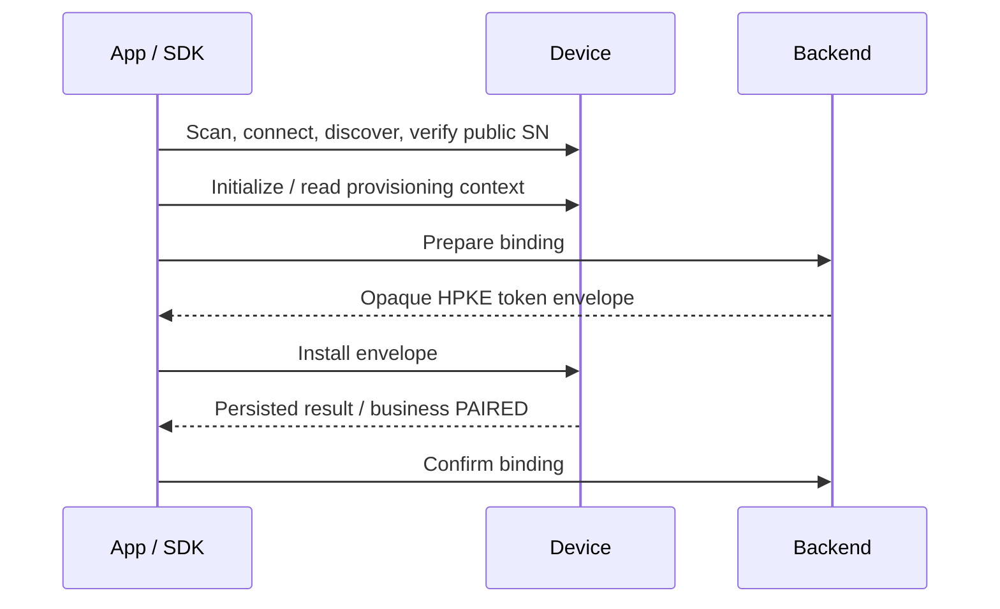

# BLE link security in the generated React Native runtime

The first-party App connection boundary requires system BLE pairing and a fresh
protected GATT read before exposing a connected device or running initialization
writes. This implements BLE-SEC-01 / SD-BLE-SEC-01. The wire contract and firmware
responsibilities are in [FIRMWARE_PROTOCOL.md](../../FIRMWARE_PROTOCOL.md#ble-link-security).
This source change is not SDK publication or phone/firmware acceptance.

## Connection sequence

Before this change, the generated runtime connected, checked public identity,
and proceeded to device initialization and business binding. Security depended
on firmware requesting and enforcing encryption; the App did not explicitly
initiate Android bonding or wait for per-connection security admission.



```mermaid
sequenceDiagram
    participant A as App / SDK
    participant O as Phone Bluetooth OS
    participant D as Device
    participant B as Backend
    A->>D: Scan, connect, discover, verify public SN
    rect rgb(230,245,255)
      alt Android
        A->>O: ensureBond / createBond if needed
        O->>D: Pair or use retained bond
        O-->>A: Matching BOND_BONDED event / existing bond
      end
      A->>D: Read protected LINK_SECURITY
      Note over O,D: iOS triggers security through this read; OS handles consent if needed
      O->>D: Establish or restore encrypted connection
      D-->>A: Current link encrypted, key size 16
      A->>A: Validate proof for this exact connection
    end
    A->>D: Initialize / read provisioning context
    A->>B: Prepare binding
    B-->>A: Opaque HPKE token envelope
    A->>D: Install envelope
    D-->>A: Persisted result / business PAIRED
    A->>B: Confirm binding
```

Only security admission is inserted. HPKE, nonce, token installation, durable
read-back, business PAIRED and cloud confirm remain unchanged. Pairing does not
make a phone the business owner. Advertising, service discovery and standard
public SN verification are outside the protected business-data exchange.

## Runtime and OS ownership

Use `createSecureBlePlxPort(manager, { platform, bonding })` with the generated
`/runtime`. Android supplies the optional native `BotaBleSecurity` TurboModule
from the SDK's `native-io` package; it contains only OS pairing calls, not another
Bota workflow engine. Do not autolink both `native-io` and the full native package.
The JavaScript-only runtime package retains structural pairing-port types without
React Native imports. Both native distributions must pass their consumer builds
and strict permission lint. Each declares its Bluetooth permissions rather than
relying on transitive AAR manifests; check the OS permission immediately before bonding
operations and handle revocation during the request.
iOS passes no Android bridge. The generic `createBlePlxPort` and independent
Android/Apple SDK facades do not automatically opt into this new RN admission.

The generated adapter awaits `ensureSecure` at its common adoption point for
initial connect, reconnect and post-OTA reconnect, before identity metadata,
time sync, provisioning state or ready events. The secure transport also refuses
business reads, all writes and subscriptions until admission. Standard
`180A/2A25` public serial is the only pre-admission value read.

Android observes bond changes for the captured device, treats `createBond` true
as start acceptance only, joins an existing pairing, and avoids restarting an
existing bond. A bond still requires the fresh protected read. Native receivers
and timers are released on success, rejection, timeout, cancellation and runtime
invalidation. No LTK is exported and no hidden unpair/removeBond API is used.
Cancelling an App request stops waiting; the OS pairing dialog may finish
independently. Its late result cannot admit a retired connection.

The default security deadline is 60 seconds (configurable 1–120000 ms), separate
from scan/connect deadlines. Cancellation requests native/GATT cancellation and
joins submitted IO before releasing the operation owner. Cleanup can outlast the
deadline; a non-settling OS operation must not be replaced by concurrent work.
Rejection, missing native code, missing/malformed probe, insufficient security,
timeout and disconnect all fail closed. A missing AUTH service or LINK_SECURITY
characteristic reports `ble_security_firmware_required` with firmware-upgrade
guidance; transport/read failures remain security failures, not proof of old firmware. The failed adoption disconnects. A new
connection always needs a new proof, including when its peripheral ID is reused.

## Discovery and required security

There is one required-security policy, with no legacy binding mode, firmware
allowlist or plaintext fallback. Scanning uses the existing discovery path and
does not require pairing or the LINK_SECURITY characteristic. A scan result is
only a candidate; it does not establish encryption or readiness for binding.
With the matching SDK installed, a missing Android pairing bridge also leaves
initialization and scanning available and refuses connection before OS access.
A missing SDK factory remains an App/SDK release integration error; the Apps do
not wrap an old SDK in a compatibility adapter.

Firmware without a valid protected probe must be upgraded before binding or
reconnecting, even for an already-bound device. Business prepare/install/confirm
runs only after security admission. Normal App BLE OTA also uses secure
connection adoption: discovery does not authorize an OTA bypass. Qualify an
independent upgrade path and upgrade unsupported firmware before rolling out the
required-security App, so devices are not stranded behind this gate.

## Release and device acceptance

Firmware support must ship before enabling the required probe in released Apps.
A matching immutable SDK release must be adopted by Demo and Bota One, followed
by native rebuilds and a new qualified runtime. Existing beta.22 (Demo) and
beta.19 (One) dependencies do not include this API/bridge. Their new source
integration intentionally refuses those old packages; it is not merge/release
ready until coordinated SDK adoption. Never ship this change as JS-only OTA to
an old Android binary. Do not fall back to plaintext to accommodate old firmware.

One cross-repository acceptance checklist:

- [ ] Android API 26–30 and 31+, and supported iOS: first bind after clearing both bonds; OS consent succeeds; encrypted probe precedes time sync, provisioning and all sensitive GATT.
- [ ] User rejects/cancels or waits past the deadline: no token install, Wi-Fi credential write or cloud binding confirmation; retry works.
- [ ] Existing bonds, phone/device reboot, ordinary reconnect and post-OTA reconnect: fresh encrypted proof, unchanged business binding generation, no unnecessary re-pair prompt.
- [ ] One-sided bond deletion, device reset, bond database full and permission revocation: explicit failure/recovery, no automatic wipe/unpair or plaintext downgrade.
- [ ] Scanning remains available before pairing and with a missing Android bridge. Old firmware remains discoverable; a missing security endpoint requires firmware upgrade and prevents binding/reconnect before business IO. False encrypted flag, short key, bad version/length and stale callbacks never admit a connection.
- [ ] The supported firmware upgrade route works before App rollout; normal App BLE OTA cannot bypass security admission.
- [ ] Unencrypted external GATT client cannot read/write/subscribe to sensitive endpoints; firmware also blocks notifications before encryption, independent of App gates.
- [ ] Air capture plus firmware connection-state logs prove encryption and a 16-byte key before the first sensitive ATT exchange, including first pairing. Verify LE Secure Connections for protection when the first pairing itself is captured; Legacy Just Works cannot satisfy that claim. The probe does not attest pairing mode. Just Works does not claim MITM protection.
- [ ] Original prepare → opaque envelope → durable PAIRED → confirm success/failure/retry behavior remains intact on the exact released App/SDK/firmware builds.

Platform references: [Android createBond](https://developer.android.com/reference/android/bluetooth/BluetoothDevice#createBond())
and [Apple encrypted-read permission](https://developer.apple.com/documentation/corebluetooth/cbattributepermissions/readencryptionrequired).
