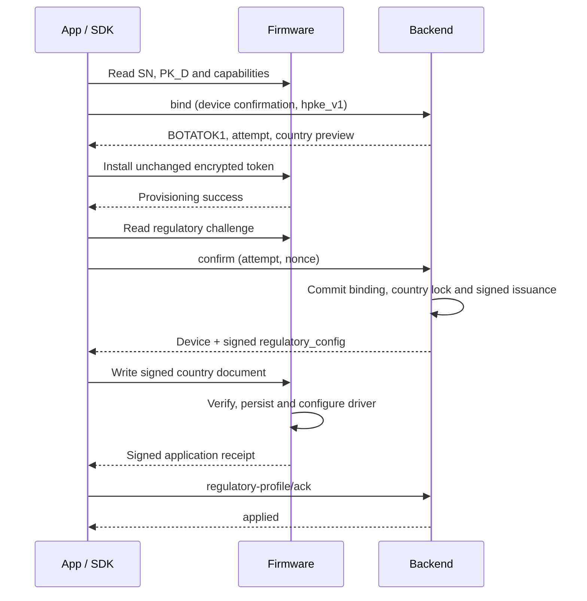

# Wi-Fi regulatory country configuration v1

**Status:** Implementation contract; coordinated changes and external firmware qualification are required before enablement.

The server selects the deployment country only from the project. There is no organization country setting or fallback. Keep the existing `bind → install encrypted token → confirm / abort` ownership transaction. Confirm returns a **readable, server-signed country document**; the App relays it and firmware verifies it. There is no separate country HPKE operation and no token or token commitment in this document. `BOTATOK1`, its HPKE suite, and Wi-Fi v3 authorization remain unchanged. New token delivery is encrypted-only; completed historical bindings remain valid and are not forced to rebind.

## 1. Country source and lock

`project_regulatory_settings.country_alpha2` is the only deployment-country source. Values are uppercase ISO alpha-2 codes that also occur in the approved SKU/profile catalog. Null clears the project country; absent settings or a null country returns `regulatory_country_required` for an admitted binding. There is no organization inheritance, sibling-project fallback, or default to CN or US. This field is separate from billing address, locale, IP geolocation, environment, and phone country.

Existing configuration administrators can change a project country through `GET/PUT /dashboard/projects/{projectId}/regulatory-country`; writes require `config.manage` and `{country_alpha2: "CN" | null, reason}` (CN is an example). Organization membership remains an authorization boundary, not a country source. Audit every change with project ID, old/new value, actor, time, and reason. End-user Apps do not select a country. The server resolves the registered hardware/model against an approved catalog containing SKU, country, profile ID, SHA-256 of the exact profile artifact, and allowed modes. An App capability claim cannot authorize another SKU or RF profile. Hardware/firmware owners must supply the approved artifacts; synthetic test profiles are not certification evidence.

Prepare stores the project country, project ID/settings revision, SKU, profile and artifact hash in the binding attempt, without writing a permanent device country. Confirm revalidates that snapshot under locks; changed source/profile returns `regulatory_context_changed` and rolls back confirmation. First confirmation atomically commits binding, token activation, the physical SN/PK_D country lock, desired configuration, and signed issuance. Existing same-country locks are reused; different country or profile is rejected. Ordinary unbind, reset, project deletion, re-registration, environment change, or a higher revision cannot unlock the physical country. Cloud environments cannot independently prove each other's history: firmware retains its country lock across them and rejects conflicting configurations. A controlled migration must reconcile history, not assume an empty database means a new physical device.

`config_id` is 16 random bytes, revision is a positive monotonic integer, and the profile hash identifies exact approved artifact bytes. Same revision requires identical country/SKU/profile/hash/modes/config ID. No country-change or profile-upgrade operation is introduced in v1. Existing fleets require explicit reconciliation before enrollment.

## 2. Two-stage binding and recovery

1. App reads device SN, PK_D and regulatory capabilities. Registration and TOFU policy are unchanged.
2. Existing bind uses `confirmation_mode:"device"`, `credential_delivery:"hpke_v1"`, and supported `regulatory_protocol_version:1`. Server snapshots the country and returns the original encrypted token and attempt fields plus `regulatory_preview`. Preview does not authorize radio activity.
3. SDK installs the original `BOTATOK1` envelope and waits for real provisioning success. Failure uses existing abort; no country lock has been committed.
4. App reads a fresh regulatory challenge and passes it to existing confirm. Server commits the normal binding and returns `regulatory_config` alongside the existing device fields. Signing failure rolls back this transaction. Do not create another binding to retry the same pending attempt.
5. SDK writes the signed document over the separate regulatory characteristic. Firmware checks signature, identity, binding context, nonce, country lock and profile, then persists and applies the driver settings. ATT success is not application success.
6. App forwards the device-signed receipt to the configuration ACK endpoint. This is configuration completion, not a third ownership phase. A post-confirm failure leaves the device bound and configuration pending; retry only country delivery/ACK. Never abort a confirmed binding or send another token because country application failed.

**Persistence timing:** an authorized first successful bind preparation pins PK_D through the existing TOFU policy so the server can encrypt the provisional token. Abort after committed preparation retains that identity pin and revokes provisional credentials. Country is only a binding-attempt snapshot at this stage; the permanent physical country lock is committed by confirm. PK_D enrollment and country-lock creation therefore do not share the same first-write timing.

**Generation rule:** the provisional token is installed with generation `g`; existing confirm advances the server binding to `g+1`. The first country document must name that same token's device/project/end-user/attempt and exactly `g+1`. Firmware records this confirmed context only after authenticating the document. Later documents must match the confirmed generation; no arbitrary generation jump is permitted. A refreshed token already carrying the confirmed generation matches directly. This rule does not change the token binary format or move ownership confirmation into firmware.

Lost confirm responses are recovered by retrying the same attempt. Return the saved issuance rather than re-signing or reactivating the token. An expired nonce, disconnect, or cleared issuance window requires a fresh challenge and configuration redelivery. Lost HTTP ACK is retried with the same persisted receipt. An applied configuration remains usable offline and across token refresh; its short installation nonce lifetime is not a country configuration expiry.

## 3. HTTP contract

Partner routes use existing project-scoped authentication and device read/write scopes; dashboard equivalents use `/dashboard/projects/{projectId}/devices/{id}` and existing organization permissions. Device credentials cannot issue Partner configuration documents. Trusted EndUser proxies must overwrite `expected_end_user_id` from their authenticated identity (GET query or POST body); the server checks it under the device lock. Never forward an App-selected owner. All responses containing issuance/receipt state use `Cache-Control: no-store`.

| Route | Additive fields / behavior |
| --- | --- |
| `POST /v1/devices/{id}/bind` | Optional capability `regulatory_protocol_version:1`; eligible devices require it and `confirmation_mode:"device"`. Response adds `regulatory_preview:{protocol_version:1,country_alpha2,source:"project",profile_id,status:"pending_confirmation"}`. |
| `POST /v1/devices/{id}/bind/{bindingAttemptId}/confirm` | Adds `regulatory:{protocol_version:1,nonce_d}` for attempts with a country snapshot. Original flattened device response adds `regulatory_config`; do not wrap the existing response in a new object. |
| `POST /v1/devices/{id}/regulatory-profile` | `{protocol_version:1,nonce_d,expected_binding_generation}` requests a fresh signed copy of the current configuration. Current bound owner/pin/generation and no pending reset required; no token rotation or country selection. |
| `POST /v1/devices/{id}/regulatory-profile/ack` | `{protocol_version:1,acknowledgement}` carries canonical unpadded base64url of the 198-byte receipt. Verify device signature, current context and recorded issuance. Duplicate successful ACK is idempotent. |
| `GET /v1/devices/{id}/regulatory-profile` | Current expected configuration, pending/applied/failed status, last result and application receipt time; no token. Missing state is explicitly `missing`. |

Nonce is 16 bytes encoded as 32 lowercase hex characters; reject the all-zero value, but individual zero bytes are valid. Generation uses the existing safe integer range; revision is a positive decimal string. `regulatory_config` has `protocol_version`, `config_id` (32 lowercase hex), `revision`, `country_alpha2`, `profile_id`, `status`, `redelivery_required` and `document:{format:"bota-regulatory-signed-v1",encoding:"base64url",data}`. Public metadata is display-only; firmware trusts the signed bytes. App does not decrypt country data. A confirm retry outside the saved issuance window remains binding-success, with `document:null,redelivery_required:true`; it must not recreate credentials.

Keep at most 16 issuance records per device for 24 hours. Persist the applied receipt hash independently so duplicate successful ACK remains harmless after issuance cleanup. Pruning issuance never clears the desired configuration or physical country lock. Late failure receipts cannot erase an already applied identical configuration. Reset, unbind, a revoked pin or superseded generation prevents stale ACK from applying to a new owner.

## 4. Readable signed binary document

All integers below are unsigned big-endian. Signature keys are already trusted cloud ECDSA P-256 keys; signer ID selects a provisioned key and never installs an App-supplied key. There is **no KEM/KDF/AEAD header, ephemeral encryption key, ciphertext, recipient decryption, or token digest** in the country document.

| Offset | Bytes | Field |
| --- | --- | --- |
| 0 | 8 | ASCII `BOTAREG1` |
| 8 | 1 | version = 1 |
| 9 | 1 | environment: dev=0, prod=1, gamma=2 |
| 10 | 1 | purpose = 1 (apply confirmed binding configuration) |
| 11 | 1 | reserved = 0 |
| 12 | 4 | first 4 bytes of SHA-256(cloud signing public key raw x\|y) |
| 16 | 32 | SHA-256(device PK_D raw x\|y) |
| 48 | 8 | confirmed binding_generation |
| 56 | 8 | positive configuration revision |
| 64 | 8 | issued_at, Unix seconds |
| 72 | 8 | expires_at, Unix seconds; 0 < difference <= 120 |
| 80 | 16 | current device challenge nonce |
| 96 | 2 | uppercase ASCII country |
| 98 | 1 | allowed modes: bit0 STA, bit1 SoftAP; 1..3 |
| 99 | 1 | reserved = 0 |
| 100 | 32 | SHA-256 of exact approved RF profile artifact bytes |
| 132 | 16 | config_id |
| 148 | variable | Seven u16BE byte-length-prefixed UTF-8 fields: serial<=32, device ID<=64, project ID<=64, end-user ID<=64, binding attempt ID<=64, SKU<=32, profile ID<=32 |
| end | 64 | server ECDSA-P256 low-S signature, P1363 r32\|s32 |

Sign `SHA-256(ASCII("bota-regulatory-config-v1") || 0x00 || body)` once; do not hash the digest a second time. The body is every byte before signature. Reject noncanonical strings, NUL, invalid UTF-8, trailing bytes, oversized fields, unknown flags, wrong purpose/environment/key/identity, invalid or high-S signature. Only historical redelivery may use an empty attempt ID. Maximum document length is **578 bytes**. Firmware validates both issuance lifetime and a monotonic device nonce lifetime (120 seconds), even without trusted wall-clock time. Consume nonce only after durable success; exact duplicate success can replay its saved receipt without reapplying. Never feed this document into the token installer or accept unsigned country fields as fallback.

## 5. Independent BLE service

Service `B07A000C-0000-1000-8000-00805F9B34FB`; characteristics use the same suffix.

| Name | Short UUID | Properties / format |
| --- | --- | --- |
| REGULATORY_CAPABILITIES | B07A000C-0001 | Read, 8 bytes: version:u8=1, flags:u8=0x0F, max_document:u16LE=578, receipt_length:u16LE=198, nonce_ttl_seconds:u16LE=120. Bits: signed document, signed receipt, persistent country lock, independence from token delivery. |
| REGULATORY_CHALLENGE | B07A000C-0002 | Read, 17 bytes: version1 + nonce16. A new full Read creates a nonce; Read Blob continuation uses the same snapshot. |
| REGULATORY_CONFIG | B07A000C-0003 | Write With Response, framed raw signed document bytes. |
| REGULATORY_STATUS | B07A000C-0004 | Read / Read Blob, 64-byte snapshot below. |
| REGULATORY_RECEIPT | B07A000C-0005 | Read / Read Blob of complete 198-byte receipt, Notify framed chunks. Empty when no completed result. |

Framing is `[index:u8,total:u8,chunk...]`, starting at 0, total1..64. Chunk capacity `min(ATT_MTU-7,244)`; MTU23 supports 16 bytes, maximum document **37 fragments**, receipt13. Strict sequential assembly; identical immediate duplicates are idempotent, conflicting duplicates/jumps/changed totals/overflow rejected. Index0 starts a new assembly. Clear partial buffers after 30 seconds or disconnect. Subscribe before writing; missing notifications recover through a complete long read. Keep coherent snapshots throughout each long read.

Status: `version:u8 | state:u8 | last_result:u16BE | env:u8 | country:2 | modes:u8 | revision:u64BE | config_id:16 | profile_hash:32`. State0 missing, 1 ready, 2 applying, 3 blocked. Missing fields are zero. A failed update with a valid prior configuration remains ready with the failure code; otherwise blocked. This does not extend the existing WIFI_STATUS enumeration. State alone is not proof for the cloud.

## 6. Firmware verification, persistence and receipt

Perform signature verification, NVM and driver work in a worker, not ATT callbacks. Capture and recheck connection, binding and reset epochs before commit. Validate the document and generation rule; check fixed SKU, country lock, config version, exact approved profile hash and supported modes. Stop radio work, checkpoint transfers, persist a recoverable journal, read back configuration, apply the driver regulatory domain and verify effective parameters. Commit the valid marker and signed receipt only after success. Restore the last valid configuration on failure; if recovery cannot be proved, keep radio off. BLE recovery remains available.

RF profile artifacts contain audited SKU/hardware, country, modes, bands, channels, power units/limits and necessary operating constraints. Hash their **original published bytes**, not platform-dependent JSON serialization. Effective radio permissions are the intersection of hardware, factory limits and approved profile. A country string alone cannot select arbitrary power tables.

The receipt is a 134-byte body followed by a 64-byte low-S P1363 signature made with SK_D over `SHA-256(ASCII("bota-regulatory-ack-v1") || 0x00 || body)`:

| Offset | Bytes | Field |
| --- | --- | --- |
| 0 | 8 | ASCII BOTARAK1 |
| 8 | 1 | version1 |
| 9 | 1 | environment |
| 10 | 2 | result |
| 12 | 32 | SHA-256(complete signed configuration document) |
| 44 | 16 | config_id |
| 60 | 8 | revision |
| 68 | 8 | confirmed binding_generation |
| 76 | 2 | country |
| 78 | 32 | profile hash |
| 110 | 16 | document nonce |
| 126 | 8 | applied_at Unix seconds, 0 if unavailable |
| 134 | 64 | device signature |

Results: 0 APPLIED; 1 INVALID_DOCUMENT; 2 AUTH_FAILED; 3 NONCE_EXPIRED; 4 CONTEXT_MISMATCH; 5 PROFILE_UNSUPPORTED; 6 COUNTRY_LOCKED; 7 REVISION_CONFLICT; 8 STORAGE_FAILED; 9 DRIVER_FAILED; 10 BUSY; 11 FRAGMENT_ERROR. Unauthenticated identity fields must be zeroed in diagnostic failures. Only a fully matched, verified result0 changes cloud state to applied. Device time is not substituted for server receipt time.

Persist success receipt with the configuration journal. After reboot, load and verify the configuration and restore the driver before reporting ready or replaying a successful receipt. It proves configuration application, not physical location, wireless connectivity or hardware certification. Offline use remains available; cloud authorization can require ACK recovery without removing a locally valid profile.

## 7. Errors, rollout and compatibility

| Condition | Outcome |
| --- | --- |
| Missing / invalid country | 400 regulatory_country_required / regulatory_country_invalid |
| Unsupported SKU/profile, missing capability, immediate binding on enrolled device | 409 regulatory_profile_unsupported / regulatory_protocol_required |
| Snapshot changed / physical country conflict | 409 regulatory_context_changed / regulatory_country_locked; pending confirmation rolls back |
| Cloud signing unavailable | 503 regulatory_signing_unavailable; retry same pending attempt |
| Invalid / stale receipt | 400 regulatory_ack_invalid / 409 regulatory_ack_stale; binding remains confirmed |
| Country application incomplete | 409 regulatory_profile_not_applied for gated authorizations; App reports bound with pending country configuration |
| Pending reset or stale binding | Reject issuance/ACK; never replay a prior owner's configuration |

Gate every emitting firmware path: scan, manual/QR Wi-Fi configuration, managed Wi-Fi connection, and local SoftAP/fast transfer. Do not alter QR parsing, Wi-Fi credential encryption, transfer framing or checkpoint rules. Existing valid profiles work offline; token refresh alone does not require another country installation. Firmware remains the final enforcement point, including legacy direct BLE commands and downgrade attempts.

`DEVICE_REGULATORY_V1_ENABLED` plus explicit project admission defaults off. Approved profile catalog defaults empty. Closing new admission must preserve existing locks, status, ACK and redelivery. This switch is independent of token policy: new token issuance is always encrypted and never downgrades because of a legacy token flag. Existing valid tokens are not revoked by this change.

Log request/device/attempt/config identifiers, generation/revision, country/profile, stage, result and elapsed time. Stages: country_resolution, bind_snapshot, confirm_issue, ble_delivery, firmware_verify, firmware_persist, driver_apply, receipt_ack. Never log tokens, private keys, full document/receipt or Wi-Fi passwords. Distinguish binding failure from post-confirm configuration failure.

## 8. Responsibilities and release order

| Owner | Required change |
| --- | --- |
| Backend | Audited project country, approved profile catalog, attempt snapshot, physical lock, atomic confirm issuance, scoped state/redelivery/ACK, admission and authorization gate; encrypted-only token issuance without BOTATOK1 changes. |
| SDK | Additive generated GATT constants, signed-document framing/validation, capability/challenge/status/receipt transport, recovery and encrypted-only provisioning admission. No country HPKE decryptor. |
| Apps | Preserve two-stage bind; advertise actual firmware capability; relay post-confirm document and receipt; retain bound state on country failure and expose configuration retry. No end-user country picker. |
| External BES firmware team | New regulatory service, existing cloud ECDSA verification, context/generation/nonce checks, persistent country lock and journal, driver application/readback, device-signed receipt, all-radio readiness gates. Keep token HPKE unchanged. |
| Hardware / QA | Approved artifact bytes and hashes; validate actual driver limits, power/channel/mode behavior, offline recovery and both STA/SoftAP. Local reference firmware is not the target. |

Release order: (1) agree contract, generated manifest and shared vectors; (2) migrate and deploy API with country admission off; (3) publish compatible SDK and build both Apps against that exact version; (4) qualify target BES firmware with the same catalog; (5) verify dev end to end and explicitly admit pilot projects; (6) separately approve gamma/prod rollout. Installing code is not enabling a fleet. Never admit a project until all clients/firmware and catalog artifacts are ready. Back out new admission while keeping recovery services and persistent locks.

## 9. Acceptance evidence

- Project-only country selection and sibling-project isolation; null/absent settings refusal; invalid/unsupported/missing country; snapshot mutation; no lock on prepare/abort; atomic confirm rollback and response-loss replay.
- Encrypted-only bind/refresh and plaintext rejection; unchanged BOTATOK1 vectors and Wi-Fi v3 token-digest authorization; old completed bindings remain valid.
- Signature/domain/key/environment/identity/generation/attempt/nonce/profile tampering, high-S, trailing bytes, oversized fields, revision rollback and cross-country reset/migration attempts.
- MTU23/185/247/517, missing notifications/long-read recovery, partial writes, duplicate frames, disconnect and bounded assembly.
- Post-confirm apply failure keeps binding; independent retry, lost ACK, late failures and stale owner/reset receipts.
- Power interruption during journal/driver/receipt stages; profile readback and radio fail-closed behavior; valid offline configuration after restart/token refresh.
- Original manual and QR configuration, scanning, managed Wi-Fi and fast transfer after successful setup; before setup every emitting firmware path is gated.
- Old database upgrade, relevant route/auth/tenant tests and exact built App/SDK/firmware versions. Software tests do not replace real hardware/RF qualification.

Implementation PRs must link dependencies, test evidence, rollout state and the external firmware handoff. Shared protocol vectors belong in app-sdk; reusable cross-product cases/results belong in bota-dev/test. Keep [design review](https://chatgpt.com/space/page_4bf470c124808191934a5d0e767f18c5), [PROTO-001](https://app.notion.com/p/3f3fb1290ea0816d93c8d3b1193bdffb), and [Wi-Fi design](https://app.notion.com/p/402fb1290ea081b4ac0bc76a5797ab8e) aligned with this canonical contract.

## 10. Implementation and firmware handoff

The dedicated `project_regulatory_settings` table preserves the base project row snapshots used by release checks. No organization country table or administration endpoint is introduced. Migration 141 must precede API writers. `DEVICE_REGULATORY_PROFILES_JSON` is an approved catalog array of `{sku,country,profileId,profileHash,allowedModes}`; it defaults to `[]`. The deployment workflow JSON-quotes catalog data before YAML rendering. `DEVICE_REGULATORY_V1_ENABLED` defaults to false. Set country through the existing configuration-administrator API, then separately admit a qualified project in `project_regulatory_settings.regulatory_v1_enabled`; Apps cannot enable this cohort. Closing the global admission switch does not disable recovery for admitted attempts or locked devices.

Use [the shared synthetic vector](vectors/regulatory-signed-v1.json) to verify config signature, receipt signature, hashes, offsets and MTU23 framing. It contains public keys only and is not an approved RF profile. Firmware acceptance must additionally cover wrong environment/SN/key/owner/attempt/generation, expired/replayed nonce, altered country/profile, power loss and driver failure. Implement B07A000C and the existing trusted P-256 verifier, preserve BOTATOK1 installation, persist the country lock across ordinary reset, and gate scan/STA/SoftAP until the profile is applied. The external BES team owns the radio driver and physical qualification; no local firmware repository is a deployment dependency.

The App preserves confirmed local binding before applying country. A failed delivery or ACK shows a pending message; entering WiFi setup retries with fresh authenticated binding metadata and a fresh nonce. The SDK subscribes before fragment writes and recovers missing notifications through complete receipt reads. Both Apps retain their published SDK dependency until the matching release is qualified; source support must not be mistaken for package adoption. No release version is invented by this change.

Offline scans may reuse a complete firmware `ready` status without opening a cloud request. Firmware still owns every RF gate. Credential setup obtains verified cloud state and ACK before granting network configuration; a failed country application never blocks disconnect.
